import ImageGallery from '../../../components/ImageGallery.astro';
import image_05 from './images/image-05.jpeg';
import image_06 from './images/image-06.jpeg';
import image_07 from './images/image-07.jpeg';
import image_08 from './images/image-08.jpeg';
import image_09 from './images/image-09.jpeg';
import image_22 from './images/image-22.jpeg';
import image_23 from './images/image-23.jpeg';
import image_24 from './images/image-24.jpeg';
import image_25 from './images/image-25.jpeg';

在宝可梦珍珠钻石（DP）中，丑丑鱼属于稀有宝可梦，能且仅能在211号道路天冠山地下1层的湖面上通过垂钓的方式来获取。

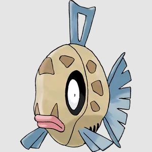

**丑丑鱼（*****ヒンバス/Feebas*****）【鱼宝可梦，全国图鉴#0349】**

通常来说，如果你能抵达这里并站上水面，你至少需要冲浪术、钓鱼竿、怪力术，也就是击败水脉市道馆（第六道馆）馆主获得矿山徽章后。同时建议携带“除雾”消除视野浓雾，来准确定位所在坐标。

首先来到祝庆市，前往祝庆电视台，走到柜台前向工作人员抽签。这就来到了第一个关键点：**抽奖数字。**

通过抽奖获得今天的“XXXXX”一组5位的随机数字。这很重要，请务必记住并保留，稍后前往天冠山有关键作用。如果你的版本高于V1.1.3，请务必连续两天来抽奖并保留，由于更新算法，需要这么做。

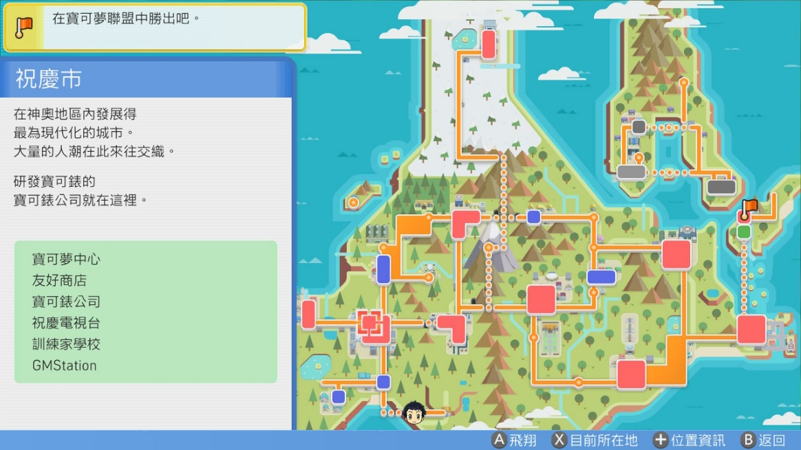

这里第二天我还中奖了，四等奖高级球一颗^ww^

<ImageGallery columns={2} images={[
    { src: image_05, alt: 'image-05.jpeg' },
    { src: image_06, alt: 'image-06.jpeg' }
]} />

<ImageGallery columns={3} images={[
    { src: image_07, alt: 'image-07.jpeg' },
    { src: image_08, alt: 'image-08.jpeg' },
    { src: image_09, alt: 'image-09.jpeg' }
]} />

随后前往天冠山，最快速的路径是飞到神和镇后向左步行即可抵达。

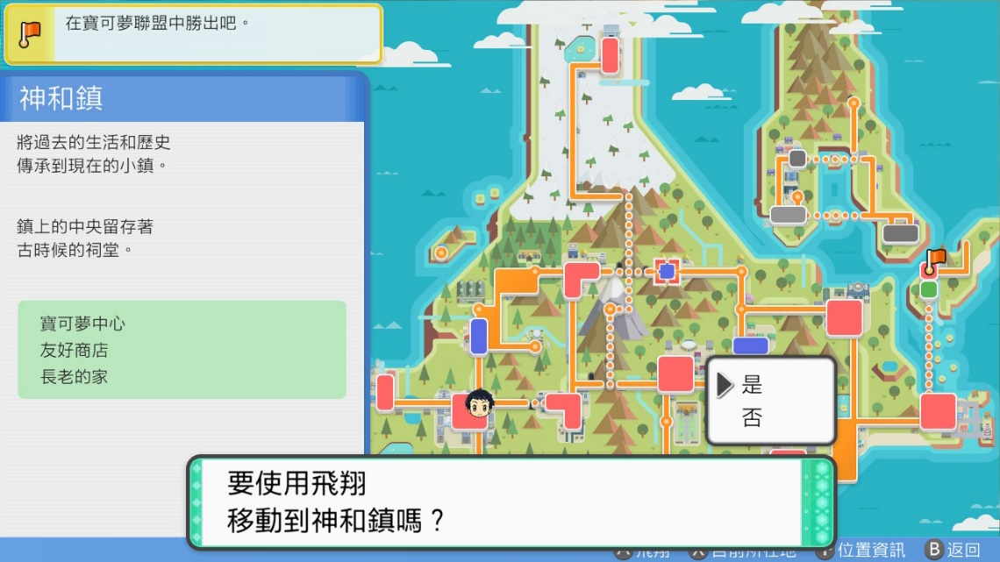

进入天冠山后，向上推开巨石，这里需要用到你的怪力术。随后一路向上左转后走到底下到地下一层。地下一层大雾弥漫，建议使用秘传招式“清除浓雾”来驱散。

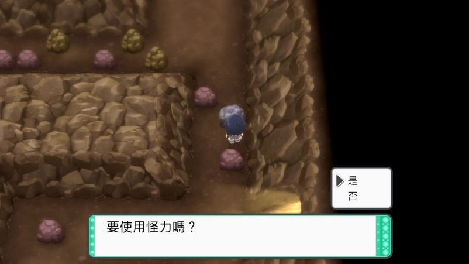

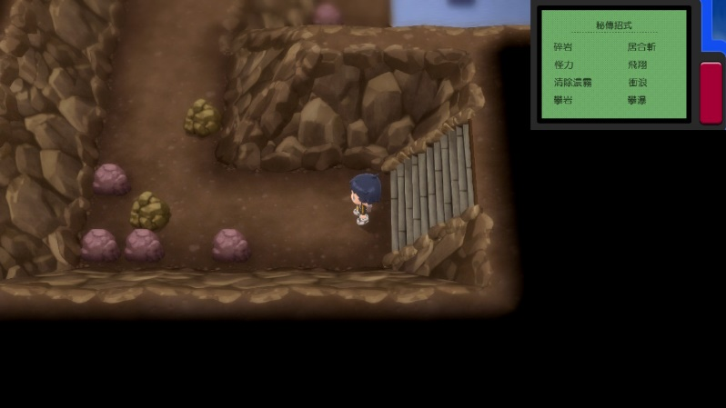

这个湖的横向宽度为18格，纵向34格，去掉中间的石头等，能钓鱼的地方有528格，其中4格有50%的概率钓到丑丑鱼。也就是说，如果不靠这方法，一开始就选择盲钓，概率仅为4/528。即便提前规划好，从最顶部开始往下钓，通常来说也要最多84次尝试才能遇到1次丑丑鱼==。

随后下湖，开始我们的定位环节。冲浪之后用十字键移动，这样按一下就是一格。

这里首先要介绍一个专门用于DP同复刻版本的工具网站：[https://lincoln-lm.github.io/JS-Finder/Tools/BDSPFeebas.html](https://lincoln-lm.github.io/JS-Finder/Tools/BDSPFeebas.html)

进入网站后，输入你刚才在祝庆电视台获得的号码，版本是V1.1.3之前的玩家，那么你会获得这样一个可能的钓点分布图。2红2绿，在今天的随机生成下，100%在2个红色或绿色的钓点，不在红则必在绿，反之亦然。

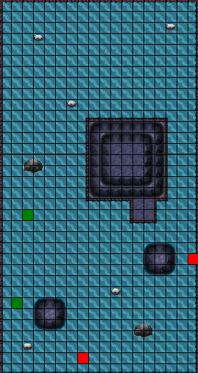

我这里版本号是V1.3.0，需要连续两天的抽奖号码，那么输入后网站会给你提供同样的4个钓点。

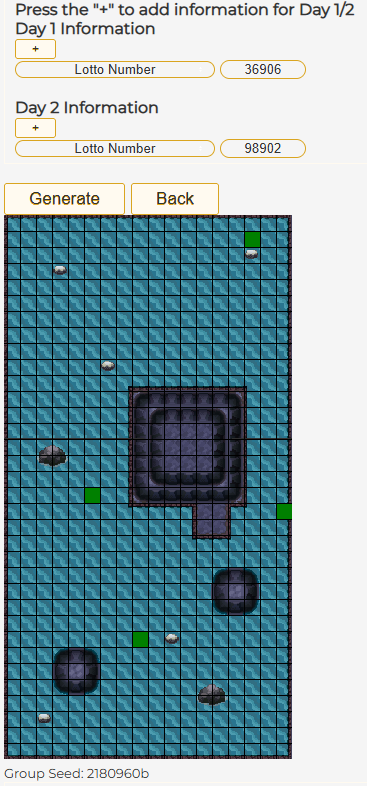

开始根据提供的钓点，进行垂钓。

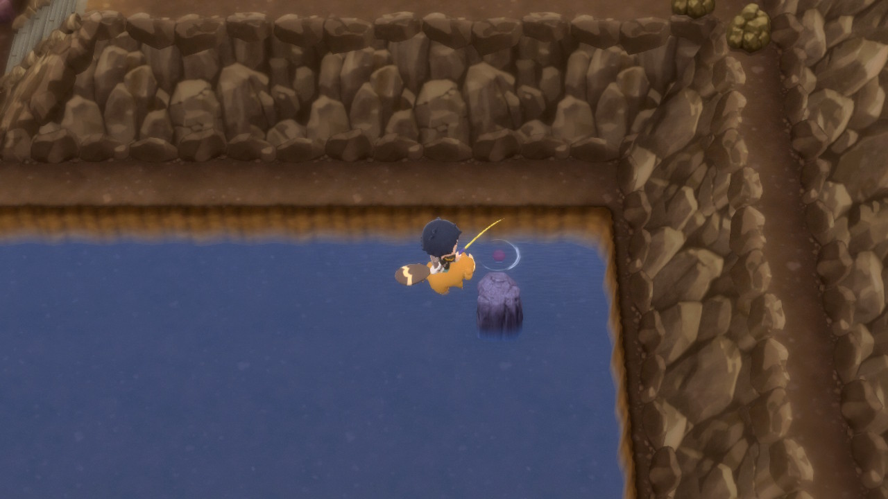

不出意外，很快就碰到了我们今天的第一只丑丑鱼。事实上，这4个钓点每天跟随你机器的系统时间更新，在这一天24点之前，只需要找到一个钓点，就可以在这里固定钓。但有一点值得注意，每次钓完后你人物模型会有细微变动，需要及时调整确保钓点落在方格内。

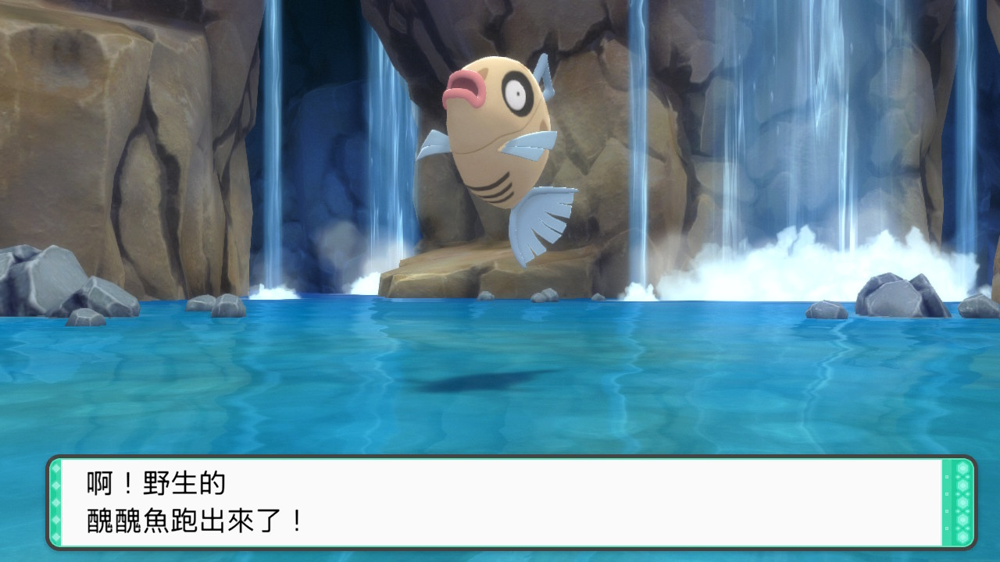

第一只就是内敛的性格！继续尝试啦。

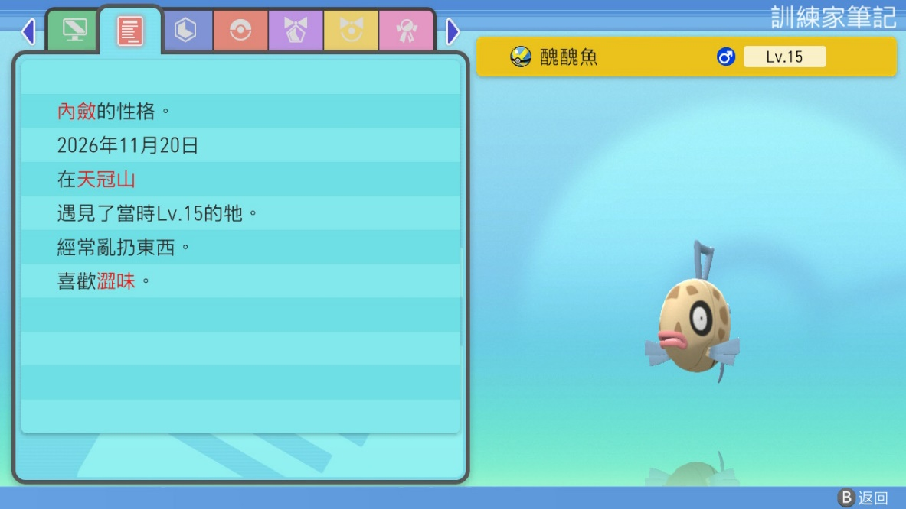

由于美纳斯需要丑丑鱼依靠美丽度达到170以上进化，我们继续尝试垂钓捕捉。

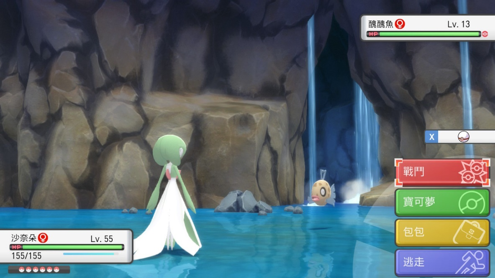

很好(๑•̀ㅂ•́)و✧第二只就是我们想要的目标了，换一个精灵球捕捉它~

这样就可以在短时间内获得大量的丑丑鱼，有耐心还可以继续尝试刷出想要的性格！

<ImageGallery columns={2} images={[
    { src: image_22, alt: 'image-22.jpeg' },
    { src: image_23, alt: 'image-23.jpeg' },
    { src: image_24, alt: 'image-24.jpeg' },
    { src: image_25, alt: 'image-25.jpeg' }
]} />
