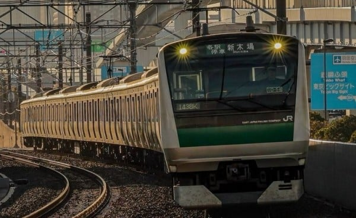

某天，在茫茫之多的硬盤內無趣地翻著要接下來要玩什麼，一個名字奇怪又熟悉的遊戲吸引了我的注意：《痴漢車両1号車～崎京線～》。由於我按照廠商進行存儲，自然發現其還有兩部姊妹篇。相較於其他兩作線路的明顯用意

2號車 「井の顕」→「井の頭」線  
3號車 「御常筋」→「御堂筋」線

本作的1號車「崎京」線正名為「埼京」線。對應的埼玉縣-東京都中的**埼**字在國內有不少的誤用為**崎**之情況，以致初見並未反應過來和現實不同僅僅虛構的迴避做法。  

下面先來看本地解說：  
*“海図では海洋に突き出した陸地の突端部の名称として、概ね「埼」を用いています。例えば東京湾付近では地図帳には野島崎、観音崎と「山遍」で記載されていますが、海図には 野島埼、観音埼と「土遍」で記載しています。海上保安庁海洋情報部は、明治時代の海軍水路部のころから、土遍の「埼」を海図に採用してきました。国土地理院では、前身の陸 軍陸地測量部が山遍の「崎」を使用していた経緯があるので、引き続き使用しています。*  
*漢字の意味として、「埼」は陸地が水部へ突出したところを表し、「崎」は水上、陸上を問わず、山脚の突出したところを表すものであることから、海洋情報部では、海上に突出した地形の名称として「埼」を採用しています。”*  
簡單可概括為**埼**的意思是陸地向水中突出的地方，而**崎**則表示山腳向水中或陸地突出的地方，因此海洋信息部採用**埼**作为向海中突出的地形的名稱。在航海圖中因循製圖慣例依舊以崎表示水中突出部。  

寫到這裡，理應也看看漢字發源的本意解釋。  
《广雅》：「崎嶇，傾側也。」（崎，崎嶇，山險。本意指地名高低不平的樣子；亦有比喻處境艱難）  
《龍龕手鑑．土部》：「埼，水傍曲岸也。」（埼，彎曲之海岸）  
也就是說兩邊對於字的本意與使用幾近完全相同，可確定國內的用法“崎京線”為**錯誤**使用。另外也注意到了國內更有使用“琦”等字的問題，該王字旁的「琦」在日文中是不使用的，同樣歸因於縣名“埼玉”的不規範表示。偏個題「崎」和「﨑」這對異體字在日本也造成了不小的困惑，這次按下不表了。  

最後簡單介紹一下本作出現的埼京線命名來由：上世紀70年代日本國鐵為緩解所謂通勤地獄的極高混雜率，祭出了名為“通勤五方面作戦”的應對措施。伴隨著都內人口外溢及東北・高崎線客流增加，這個沒有實際命名土建線路的運營系統逐步浮出水面。  
當時「公園都市線」這一名稱得到了沿線市町村的青睞，但是日本國鐵方面對此表示反對，理由是JNR認為這一名稱與「東急田園都市線」過於相似。彼時JNR在命名線路時通常的做法是使用沿線中心城市的名稱，從起點和終點中各取一字；還有直接使用起點或終點城市或車站的名稱，抑或使用沿途的綜合地名。因此該線路以埼玉縣和東京都各取一字，“埼京線”由此得名。  
值得註意的是「埼京」（さいきょう）在此使用了**湯桶読み**。更有趣的是，埼玉縣內的埼玉市官方寫法是平假名的「さいたま市」。決定這寫法的原因是，「埼」在2010年才被收錄為常用漢字，平假名比較好唸，並且希望與埼玉縣有區別。  

