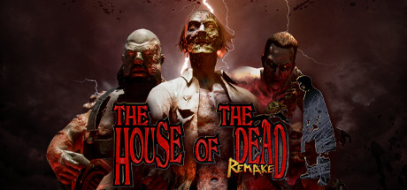
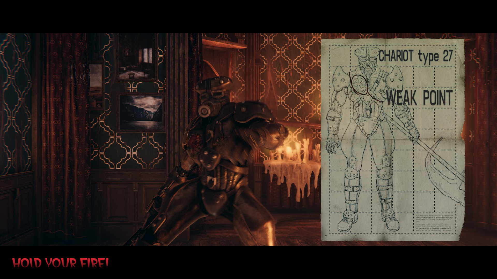
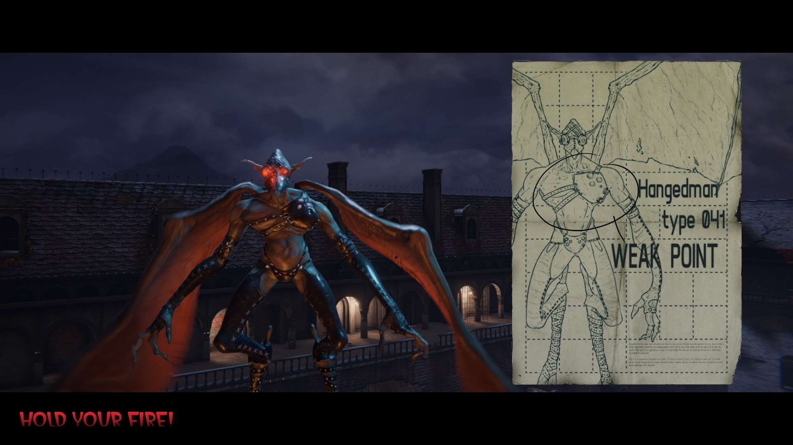
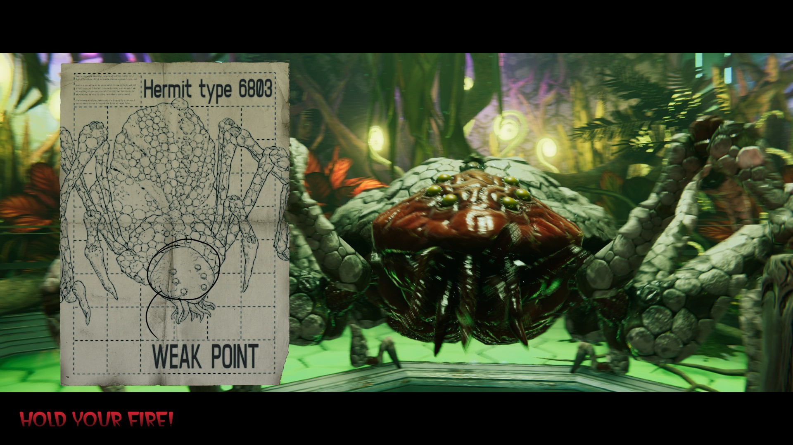
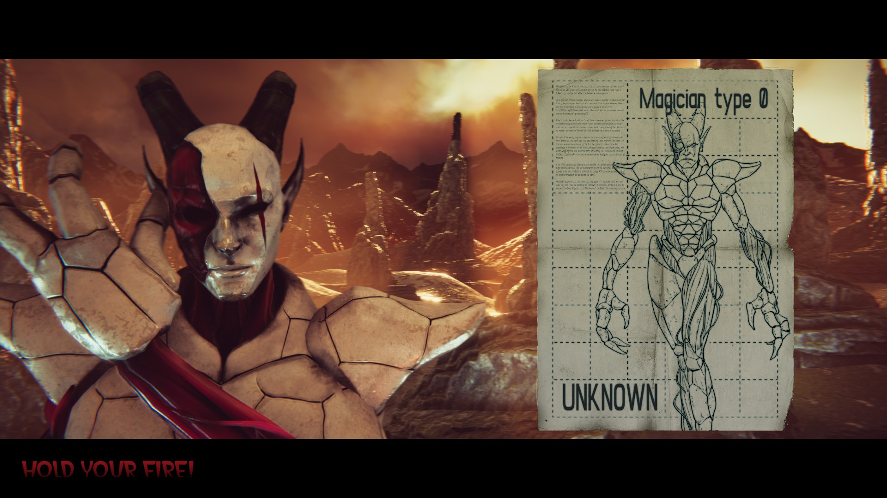
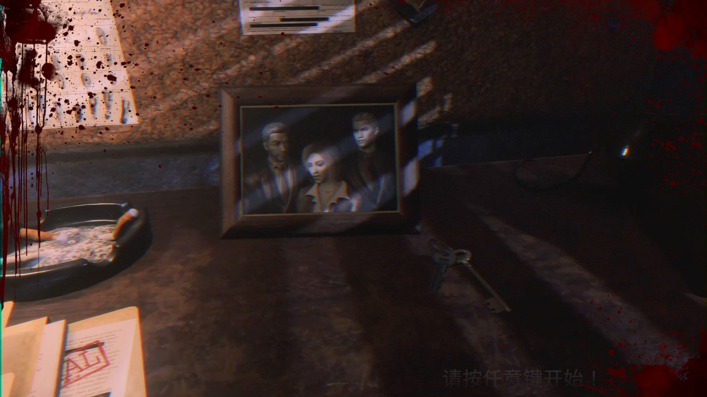
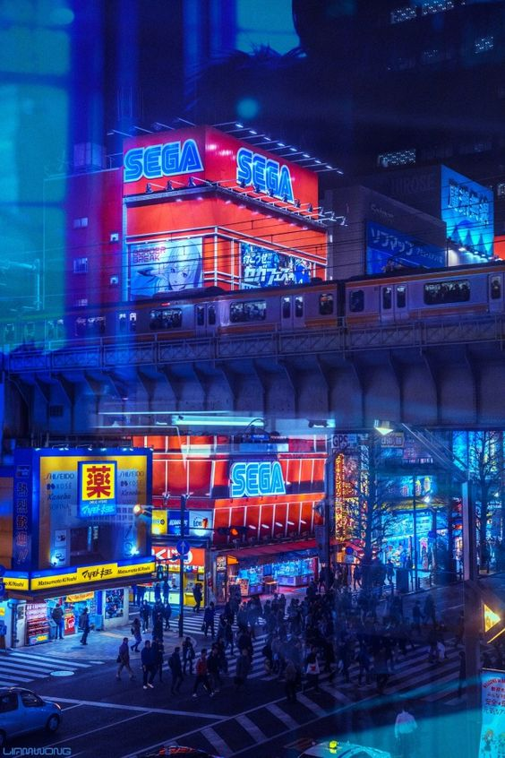

## 1. 背景

1996年由SEGA AM1小组（2000年后以SEGA Wow.存在）开发的初代死亡之屋在日本及欧美发售，并于1998年登陆PC。2019年9月经世嘉许可，由波兰开发商Forever Entertainment旗下子公司MegaPixel Studio负责1代和1998年发行的2代的重制工作。2022年4月7日于Nintendo Switch发售并在同年4月28日登陆Steam、PS4、Xbox One和Stadia等平台。

## 2. 乏善可陈的优点

- 环境交互

这个值得单独说说。纵观全系列特别是以3代和4代为代表，在环境交互这方面尤为重视，击碎部分环境物品可以获得增加生命值或增加分数的奖励。本次重制版依然保持了该设定在较为线性的关卡中。对那些手里停不下来的玩家十分友好。

- 路线分支选择处

关卡内不少分支由玩家自己通过射击选择；同时在营救环节的结果也会导致路线不同

- 武器选择的增加

在关卡攻关过程中，击碎环境物以获得除经典Pistol外的其他武器并在之后的游戏中装备（需要完成一次全人质救援成功）

支持中文（姑且算是优点吧XD）

## 3. 难以接受的缺点

- 场景部分灯光过暗，瞄准时经常会偏离以及难以分辨（当然原版PC移植中射击闪屏这个问题也很离谱XD）

- 音乐的整体使用

最大的败笔无疑是Chapter4中玩家初见Magician，这一系列吉祥物的Boss时使用的BGM。较之原版音乐相去甚远，当初在街机厅被神秘人造之物震慑到压迫感荡然无存。初代整体氛围也有不少和氏风情，而在MegaPixel这家波兰开发商的手中总是少了一些余韵。

- 群斗模式

严重的卡视角问题。非宽屏在此模式下可能遭遇ss的突然袭击、无法准确击中ss甚至是来自屏幕外的攻击，暂时未得到修复

- 光枪游戏不支持光枪

- 恐怖感削弱

这个比较主观。对于我而言本次重制版给我带来的恐惧以及沉浸感远不如上世纪末发售的原版，原版中部分像素化的处理以及较高的对比度反而能够营造在一个未知神秘的诡异洋馆中发生的猎奇事件

## 4. 与原版的比较

- 增加了现代得分评判机制（连杀 鞭尸得分）

在现代得分设置下，对ss的尸体继续攻击可以获得额外的分数。在一定时间内击杀超过1名以上ss亦会增加你的分数

- 射击手感和反馈

令人不快的射击换弹硬直在Unity的加持下更显诡异。笔者在原版一币通关数十次的情况下，尝试新版游戏5次后仍然不能重新打回一币大关，无伤过关应该是更加困难了。

- 新增的拍照模式

- 新增了成就系统、统计、排行榜、影集

- 结局的判定：原版与重制版三个结局内容是共同的，但是判定标准发生了变化。

- 原版中过关后会为玩家增加血量，在之后的续作中也延续了下来；但在本次重制版中该设定被取消

- ss被击杀后不再消失

- Arcade Mode下ss的攻击逻辑和判定

如胖子和流星锤的攻击距离和打断攻击的距离均有改变；同时会注意到在第三关后电锯男攻击时间隔缩短了

- Boss攻击机制部分改动

Chariot在硬直后不再后退 HangedMan的Hitbox判定范围缩小 Hermit攻击方向增加

## 5. 综合评价

难度区分总体上在ss的攻击欲望及反应时间、ss的韧性和ss的瞬时数量

Boss难度区分比较明显的是终关Boss Magician在简单难度下，血量较低时并没有回首掏的攻击姿态，不仅仅只是单纯削弱血量，相较街机难度对新手更加友好

画质表现个人认为只能称为合格，在2022年的当下基于Unity的开发，部分场景依旧会有掉帧情况发生，优化空间依旧很大。

心中郁结更是集中萦绕在Magician身上，本作完全没能还原当年初见的各种情感交集。即便后续在2代和4sp中再次以Boss会面或是3代4代中的金人彩蛋客串，最传奇的Type已经不复存在了

## 5.5/10

对于情怀玩家可以入手尝试，新人则不建议通过此作了解光枪游戏

## 6. 尾声

说起来也是很少游玩光枪游戏了，这类经常出现在街机厅的常客类型目前也在时代面前随着街机厅的陨落而一同走向小众。不能否认HOD系列以及其他光枪射击游戏在街机厅为我的童年时光带去了无数欢乐记忆和体验，但光枪游戏令人诟病的点从始至终都是如站桩打靶，流程线性单一，高分背板，缺少多周目之动力等…就连名字中的设备光枪都早已沦为无人问津的外设。近年来用Joy-con或是前些年的Wiimote也无法完美还原手感；老东家世嘉也是在暗淡中草草处理了旗下实体街机业务。也许是缺点过多或是难以优化迭代，亦可能是时光荏苒。光枪游戏荣光不再，大概我们必须要和那个时代说声再见了

*—— Ending ——*

*筆者註：原文初刊於Bangumi，僅作抄錄**。*
